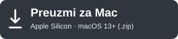

# Kajron Atomic Studio

**Offline OBS ticker, chyron and lower third video generator for Windows and macOS.**

**Klikni na plavo dugme da odmah skineš Windows instalater.** Pokreni preuzeti `.exe` i prati instalaciju. Oba jezika su uključena.

**Click the blue button to download the Windows installer directly.** Run the downloaded `.exe`. English and Serbian are included.

[Windows bez instalacije / Portable ZIP](https://github.com/srdjankotarlic/kajron-atomic-studio/releases/latest/download/Kajron-Atomic-Studio-Windows-Portable.zip) · [Sva preuzimanja / All downloads](https://github.com/srdjankotarlic/kajron-atomic-studio/releases/latest)

[English](README.md) · [Srpski](docs/README.sr.md) · **[Download / Preuzmi](https://github.com/srdjankotarlic/kajron-atomic-studio/releases/latest)**

Type your text, adjust the font, colors, size and scroll speed, then export a real
**WebM, MOV or MP4 video**. Add it as a looping **Media Source** in OBS Studio.
Everything runs locally. No account, subscription, watermark or internet connection
is required to create your videos.

The app includes **English and Serbian**. Change **English / Srpski** at the top
of the window; your choice is saved. Changing the interface language never changes
your ticker text.

## Download and install

Get the files from the official **[Releases page](https://github.com/srdjankotarlic/kajron-atomic-studio/releases/latest)**.
GitHub's green **Code** button downloads source code, not an installer.

| System | Download | Installation |
| --- | --- | --- |
| Windows 10/11, 64-bit Intel/AMD | [**Download Windows installer (.exe)**](https://github.com/srdjankotarlic/kajron-atomic-studio/releases/latest/download/Kajron-Atomic-Studio-Windows-Setup.exe) | Run the installer. Desktop and Start shortcuts are created for your user. |
| Windows portable | [Download portable ZIP](https://github.com/srdjankotarlic/kajron-atomic-studio/releases/latest/download/Kajron-Atomic-Studio-Windows-Portable.zip) | Extract the **entire** folder and run `Kajron Atomic Studio.exe`. Keep all files together. |
| macOS 13+, Apple Silicon | [**Download Mac app (.zip)**](https://github.com/srdjankotarlic/kajron-atomic-studio/releases/latest/download/Kajron-Atomic-Studio-macOS.zip) | Extract the app and move it to Applications. Intel Macs are not supported by this build. |

The video encoder is included; users do not need to install FFmpeg, Node or Python.
The Windows installer is unsigned. The Mac build is ad-hoc signed and is not
notarized; OS security checks can prevent launching downloaded builds. Publisher
signing certificates are not included in this project.

`SHA256SUMS.txt` in each release records the exact download hashes. The
**Encoder-Sources** archive is for developers and license compliance, not needed
to run the app.

## Features

- Scrolling left/right or a static ticker, with a live preview and complete text cycles.
- Font size, bold and uppercase, text/bar/accent colors, opacity and corner radius.
- Optional fixed label, ticker height, frame position and margins.
- **Text only** mode: letters over a fully transparent background, without the bar or label.
- Import **TTF, OTF, WOFF and WOFF2** fonts into the app's private font library.
- WebM VP9, MOV PNG or ProRes 4444, and MP4 H.264 output.
- Smaller file, balanced and highest quality settings; strip-only or full-frame export.
- 720p, 1080p, 1440p, 4K or custom dimensions; 25/30/50/60 FPS.
- Save/open JSON projects on either platform. Imported fonts persist after restart.
- Offline operation, native save dialogs, progress and export cancellation.

## Make your first ticker

1. Enter your text in **Text**. Line breaks become bullet separators.
2. Adjust **Style** and **Motion**, or choose a preset.
3. For transparent letters only, enable **Text only — fully transparent background**.
4. Choose **Smaller file** and **Ticker strip only** to reduce file size.
5. Click **Save WebM**, **Save MOV** or **Save MP4** and choose a folder. The save dialog starts at your Desktop. Wait for the export to finish.

| Format | Transparency | Best use |
| --- | --- | --- |
| WebM / VP9 | Yes | Small transparent overlays for OBS; encoding can take longer. |
| MOV / PNG | Yes | Lossless graphics with alpha, smaller than ProRes for typical tickers. |
| MOV / ProRes 4444 | Yes | Editing workflows; available under Highest quality and produces large files. |
| MP4 / H.264 | No | Small video with an opaque background. Disabled in Text only mode. |

File size depends on text length, duration, dimensions, frame rate and content.
Compression keeps the whole text cycle. A very long line at a large font size may
exceed the 32760-pixel text texture limit; reduce the font size or shorten the text
if prompted.

## Use it in OBS Studio

1. Open **Sources → + → Media Source**.
2. Enable **Local File** and select your exported video.
3. Enable **Loop**. Optionally enable **Restart playback when source becomes active**.
4. Place the source above cameras and other content, and position it at the bottom.
5. Use **Add Existing** to reuse the same Media Source in another scene.

This app produces media files. You do not need a Browser Source or a hosted web page.

## Fonts and portable projects

In **Text**, click **Add fonts…** and choose one or more font files. They appear
with the **Your font** label and remain available after restart. Limits: 32 fonts,
10 MB per font and 40 MB in total. Importing a font does not install it system-wide.

On another computer, import the same original font before opening its project.
A missing font falls back to Arial with a notice. Exported videos already contain
the rendered letters and do not require the font on the OBS playback computer.

Save/open projects with **Ctrl+S / Ctrl+O** on Windows or **⌘S / ⌘O** on macOS.
Projects are compatible across platforms, including older Kajron Studio projects.
Projects do not embed font files. No user fonts or projects are shipped in releases.

## Source, build and verification

Application code: **MIT**. The separate encoder and bundled runtime retain their
own licenses. See [third party notices](THIRD_PARTY_NOTICES.md),
[build instructions](docs/BUILD.md) and [validation notes](docs/VALIDATION.md).
Exact encoder source archives and build recipes accompany the binary downloads.

Found a problem? [Open an issue](https://github.com/srdjankotarlic/kajron-atomic-studio/issues)
with your OS, app version, export format and steps to reproduce it. Please use
sample text rather than private projects.

Search terms: OBS Studio ticker generator, news ticker, chyron, lower thirds,
transparent video overlay, scrolling text, livestream graphics, kajron generator,
generator kajrona, srpski, English, Windows, macOS, offline.
